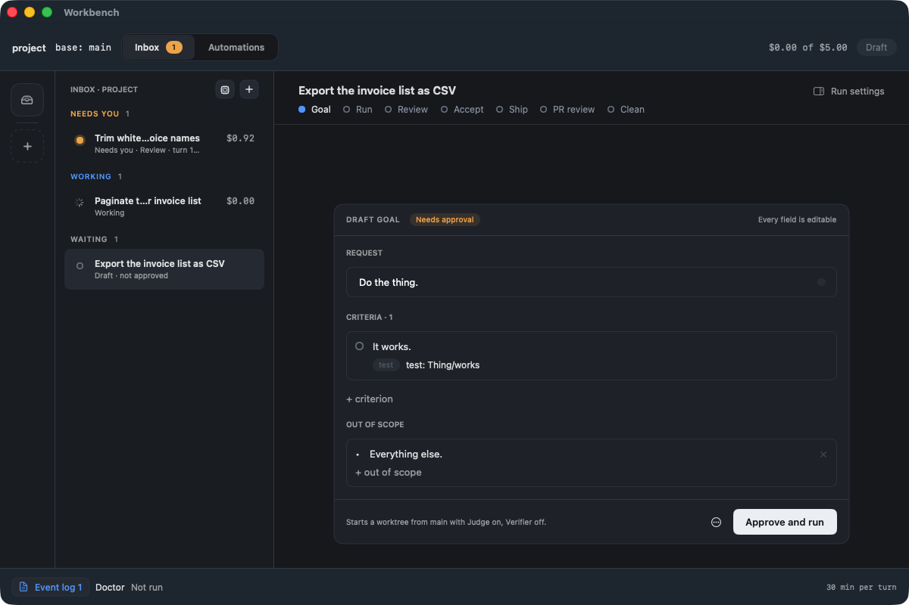
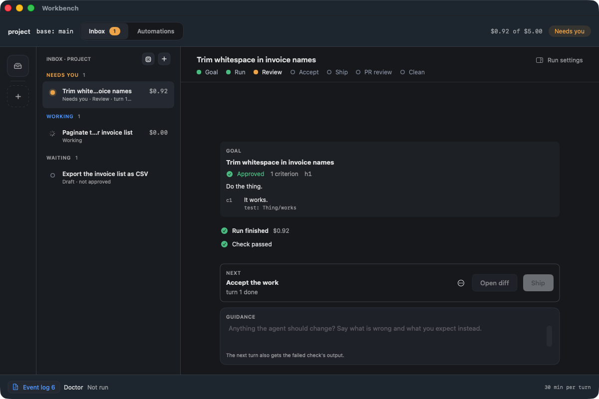
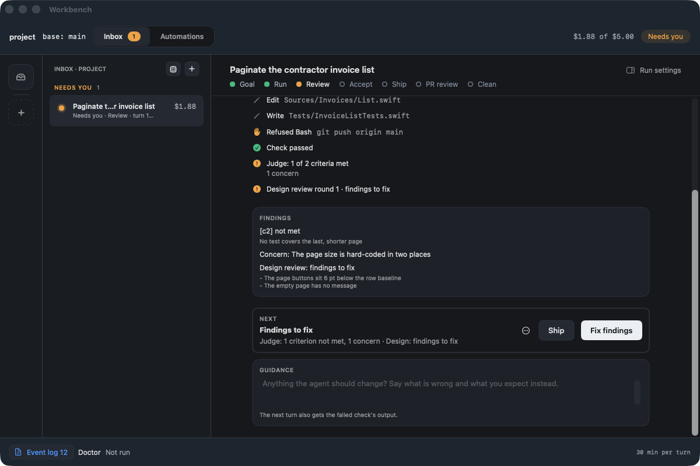

# Workbench

Hand a coding task to an AI agent, and get back work you can trust.

Workbench runs the task in an isolated git worktree and gives you back the diff, the check results, a judge's
verdict and screenshots of the result, with one decision to make: accept, send it back, or discard. It is a
macOS app and a `workbench` CLI; the library and the CLI also build and pass their tests on Linux.

```
Write a goal → you approve it → the agent works in a worktree
             → check, verify, judge, review → you accept, send back or discard
             → ship opens the pull request → you merge
```



## What you get

- **A goal first.** A markdown file with the request, checkable acceptance criteria (each can name the test, command
  or screenshot that proves it) and what is out of scope. You approve it once, before anything runs. A goal can be
  written by hand, drafted by an agent, or started from a chat.
- **Isolation.** Every thread has its own worktree and branch. The boundary is the worktree, a tool allowlist
  and a budget; nothing asks you for permission mid-run, and anything outside the allowlist is denied and shown
  in the review.
- **A verified result.** After each turn Workbench runs the project's own check, then optionally a **verifier**
  (an agent that drives your app and takes the screenshots the goal names), a **judge** (does the diff meet each
  criterion?) and further **review stages** such as design. A failed step goes back to the agent; a fix starts
  again at the check.
- **One decision.** The review card shows the changed files, the check, the judge's findings and the cost. You
  accept, send it back with a note, or discard.
- **Ship.** `workbench ship` pushes the accepted branch and opens the pull request with its sections filled in from
  the goal and the diff, then an automated reviewer can go over the PR. The agent never holds credentials, and
  Workbench never merges for you.
- **Several threads at once.** Up to `max_active_threads` per project (default 3), each with its own ports, shown in
  the inbox rail with a mark for working, needs you and done.
- **Scheduled tasks.** Tasks in `.workbench/tasks/<name>/` run on a timer through the same thread path and open a
  pull request.
- **Your choice of agent.** Claude or Codex, picked separately for drafting, coding, judging and review.





## Install

macOS 14 or later, Xcode 26.6 (the version in [`.xcode-version`](.xcode-version)), and `claude` (and optionally
`codex`) on your `PATH`.

```bash
scripts/bundle-app.sh --install     # builds ~/Applications/Workbench.app and opens it
swift build                         # just the `workbench` CLI and the library (also works on Linux)
```

`scripts/wb <args>` rebuilds the CLI first and then runs it, so you never run a stale binary. Right-click the Dock
icon, Options, Keep in Dock, to keep the app there. A Workbench that is already running is never quit for you.

## Use it

In the app, open a project, press **New goal**, write the request and approve. From the CLI, in a git repository:

```bash
workbench init                      # writes .workbench/config.toml; edit the check command
workbench goal new add-retry        # a thread and a draft goal; edit it, then:
workbench goal approve
workbench run                       # worktree, agent turn, your check; ends with a result
workbench review                    # the diff, the check, the findings
workbench accept                    # your decision (or send-back / discard)
workbench ship                      # push the accepted branch and open the PR
```

`workbench help` lists every command and `workbench help <command>` says what one changes. Add `--json` to read
state from a script ([`docs/spec/cli-json.md`](docs/spec/cli-json.md)).

## Configure a project

`.workbench/config.toml` in the project says how to check it, which tools the agent may use and which reviews run.
Everything is declared by you; Workbench never guesses a stack.

```toml
[tools]
available = ["Read", "Edit", "Bash"]        # what the agent can see at all
allowed = ["Read", "Edit", "Bash(swift test:*)"]

[review]
stages = ["pr-review", "design"]

[review.stage.design]
skill = "design.md"                  # a skill in your repo that reviews the screenshots
applies_to = ["Sources/**"]

[run]                                  # how to start your app, for the verifier
command = "npm run dev:mock"
ready_url = "http://localhost:{port}/"
```

`workbench doctor` runs the declared setup, check and verify in a throwaway worktree and says what is wrong. The
goal and event-log formats, exit codes, scheduled tasks and `workbench new` are specified in [`docs/spec/`](docs/spec/).

## How it stays reliable

Workbench starts agents and commands as child processes, so most of its rules are about those:

1. **A turn always ends, and says how.** Exactly one `turn.ended` per `turn.started`, also on stop, timeout, crash
   and restart.
2. **Children start through one function** (`Spawner`), in their own process group, with no inherited descriptors.
   No blocking waits; exit comes through a watcher.
3. **The event log is the state.** One writer, appended JSON lines, no gaps; the UI and the CLI derive everything from
   it. Agent transcripts are stored verbatim beside it.
4. **Everything is bounded:** line size, log size, output, timeout, budget.
5. **Untrusted text never reaches git or a path** without validation.
6. **Hangs, leaks and leftover processes are tested** against a fake agent that can hang, crash and ignore SIGTERM.

## Contributing

Read [`AGENTS.md`](AGENTS.md): commands, conventions, the toolchain, and how a change ships (a pull request per task,
reviewed by a second agent, never merged by the author). Design rules for the app are in
[`docs/DESIGN.md`](docs/DESIGN.md). Before pushing, `scripts/check-changed.sh` lints and tests what your branch changed;
CI runs the full check.

```
Sources/WorkbenchCore/   the library: runner, event log, checks, review, ship, config
Sources/workbench/       the CLI
Sources/WorkbenchApp/    the SwiftUI app (macOS only)
Sources/fake-claude/     the test double
Fixtures/app/            projects the app is checked against on screen
docs/spec/               formats and contracts
scripts/                 checks, bundle-app.sh, verify-cli and verify-app scenarios
```

The project's history is in its pull requests; `docs/plan/` holds the phases still open, `docs/archive/` the finished ones, and `docs/later/` what is deliberately
not built yet.
