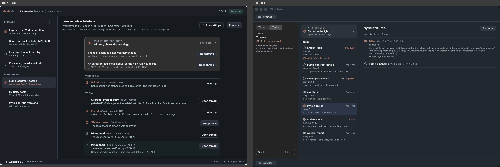
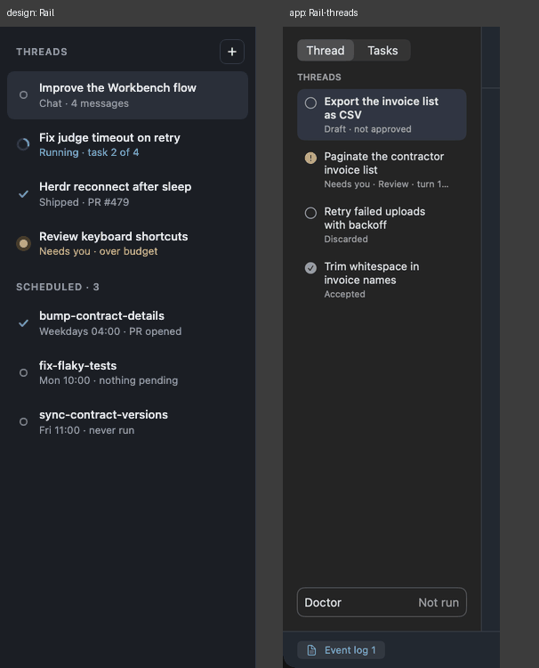
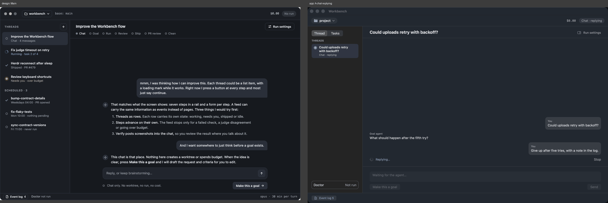
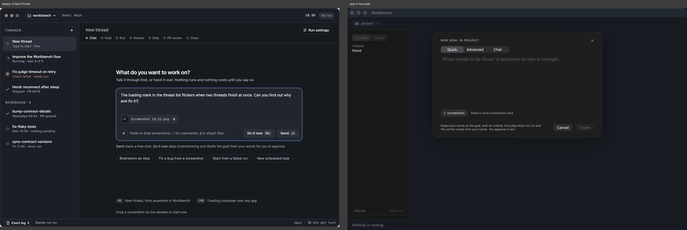
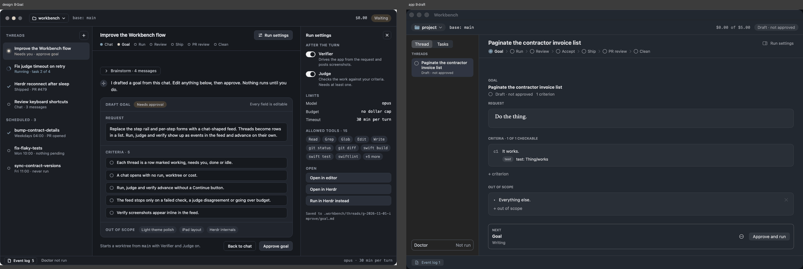
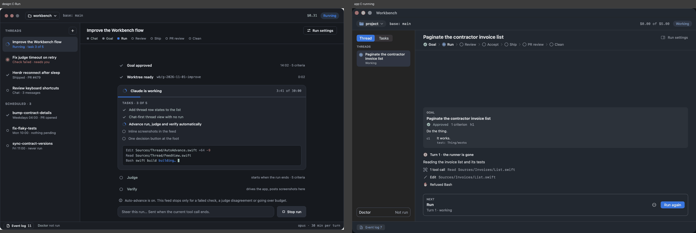
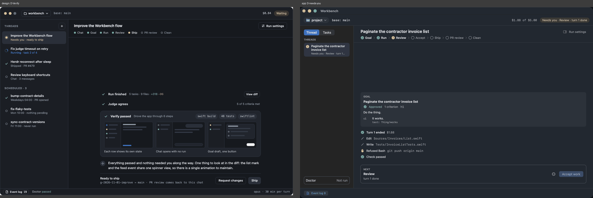

# Design parity: the chat-feed artboards against the app

Checked 2026-11-03 against `main` at `a46c4b7` (P22 slices 0 to 6c merged), preview on (`WORKBENCH_CHAT_FEED=1`).
Each image below is the artboard on the left and the app on the right, at the artboards' own size (1240×800, the rail 288×720), in
the dark appearance. [`docs/DESIGN.md`](../../DESIGN.md) says that where it and an artboard disagree on a layout value, DESIGN.md is
what ships and the artboard gets fixed; so every row below ends in a decision for you: **App** (change the app to match), **Artboard**
(the app is right, update the artboard and DESIGN.md) or **Decide**.

## How this was made (and how to redo it)

1. The artboards import `./support.js`, the design canvas's runtime, which is not in the repo, so they drew as unstyled pages with no
   rail. [`support.js`](support.js) in this folder is a stand-in for what the files use (`{{path}}`, `<sc-for>`, `<sc-if>`,
   `<dc-import>`, `<helmet>`, `Component.renderVals()`), so they now render in any browser. It is a reconstruction: if the canvas draws
   something it does not, the canvas is right.
2. `scripts/render-artboards.sh <dir>` screenshots every board with Chrome headless.
3. `scripts/verify-app.sh` shot each matching fixture scenario at 1240×800 (`WORKBENCH_CHAT_FEED=1 VERIFY_WINDOW_SIZE=1240x800`).
4. `scripts/design-pairs.py <artboards> <app shots> <out>` makes the pairs in [`parity/`](parity/).

The pairs for the answered chat, the approved goal and the review with files are linked but were not gone through line by line. Not covered: **light appearance** (the live app follows the system, which was dark; the light renders in the test suite draw native
controls as placeholders and are not a fair comparison), the **Run settings inspector** and the feed's thumbnails (no fixture shows
them open), the **E · Autopilot** boards (dropped from P22), and anything that moves. The `running` fixture has a dead runner (a
fixture cannot have a live one), so C compares a live design with a "runner is gone" app.

## Decisions (2026-11-03) and the order of the fixes

| Question | Decision |
|---|---|
| Rail and Tasks (1, 2) | **Follow the design.** One rail: *Threads* with a `+`, then *Scheduled*. A task opens the design's task page. The `Thread \| Tasks` switch and the three-column Tasks screen go. |
| Palette (12) | **The artboards win.** `Theme.swift` and the rail colour take the artboards' values. |
| New thread (5) | **An in-feed screen**, reached from the rail's `+`; the popover stays for ⌘N. |
| Phase row (9) | **Keep Accept, add Chat.** The artboards get an Accept step; the row shows Chat first. No core change. |
| Everything marked *App* (3, 4, 10), type (13), footer (11) | Done to the design: the thread title `.title3` (15 pt), the footer carries Doctor and the per-turn limit. |
| Steer this run, Autopilot | Stay out (P22 decision 5; Autopilot dropped). |

One PR each, in this order; each starts from its own goal file.

1. **Tokens and chrome:** palette and rail colour, thread title size, a short state pill, the footer (11, 12, 13, part of 10).
2. **The feed column and the chat:** a centred column, the chat's messages and composer as designed (3, 4).
3. **The phase row:** Chat first, the artboards' marks, shown on a chat (9).
4. **The rail:** one list, `+`, *Scheduled*; the Tasks mode goes (2).
5. **The task page:** header, per-task *Will it run tonight?*, runs by day with a button each (1).
6. **The new-thread screen** (5).
7. **The goal screen:** *Draft goal* card with `Back to chat` and `Approve goal` inside it, the inspector open by default (6).
8. **Run and Verify:** a live card with progress and timer, plan tasks, pending *Judge* / *Verify* rows, screenshots in the feed, *Ready to
   ship* with `Request changes` and `Ship` (7, 8). The biggest, and it needs core events for plan progress; it gets its own plan first.

## What differs, most to least structural

| # | Where | Design | App | Decide |
|---|---|---|---|---|
| 1 | **Tasks screen** | The task is a page: header (name, schedule line, "Defined in …"), `Run settings` and `Run now`, a per-task *Will it run tonight?* card with its warnings and an action each, then runs grouped *Yesterday / Today*, each with a status mark, time, trigger and summary and one button (`View log`, `Open thread`, `Re-approve`). The tasks are in the rail, under *Scheduled*. | Three columns: a summary rail (*7 tasks · 1 did not end well*), a task list column with one *Will it run tonight?* card for the whole project at its top, and the selected task's runs as dense text lines with no day groups and no buttons. | **Done, PR 4 (the rail) and PR 5 (the task page)** |
| 2 | **Rail, all screens** | One list: *Threads* with a `+` button, then *Scheduled · 3*. 288 wide, titles on one line, the state line coloured by state (blue running, amber needs you, green shipped). | `Thread \| Tasks` switch; threads only; about 220 wide, titles wrap to two lines and the state line is grey and truncates (`Needs you · Review · turn 1…`); no `+`; *Doctor* sits at the rail's foot. | **Done, PR 4** (one list, `+`, Scheduled; 288 wide; Doctor in the footer) |
| 3 | **Column width** | The feed is a centred column about 540 wide; bubbles and agent text sit close together. | The feed fills the window; at a roomy size the person's bubbles sit far right and the agent's text far left. | **Done, PR 2** |
| 4 | **Chat** | Agent text with a sparkle avatar, markdown (a numbered list), bubbles with no label; a one-line composer with a round send arrow inside it, *Chat only. No worktree, no run, no cost.* under it, and one prominent `Make this a goal →`. | A `Goal agent` / `You` label above each message, plain text, a tall box with `Make this a goal` and `Send` as two separate buttons. | **Done, PR 2** |
| 5 | **New thread** (G) | An in-feed screen, *What do you want to work on?*, with a composer, attachments, `Do it now ⌘↵` and `Send ↵`, and four starter chips. | The New goal card as a popover with *Quick / Advanced / Chat*, a serif text area, `Create`. | **Done, PR 6** (the other two chips wait for what is behind them) |
| 6 | **Goal** (B) | A *Draft goal* card with a *Needs approval* pill, `Back to chat` and `Approve goal` inside it, a *Brainstorm · 4 messages* fold above it, the request in sans, criteria as bordered rows, out of scope as chips, and the Run settings inspector open beside it. | A *Goal* section, the request in a serif face, criteria with their proofs (`test: Thing/works`), out of scope as a list, a separate *Next* card with `Approve and run`, the inspector closed behind a button. | **Done, PR 7** (`Approve and run` stays; no `Back to chat`; outstanding: out of scope as chips) |
| 7 | **Run** (C) | A live card: *Claude is working*, a progress bar and `3:41 of 30:00`, the plan's tasks (`3 of 5`) with ticks, a tail of the tool calls, then pending *Judge* and *Verify* rows, an auto-advance note, and `Steer this run…` with `Stop run`. | The goal card, a *Turn 1* row, grouped tool lines, and the *Next* card with `Run again`. No progress or timer, no plan tasks, no pending rows, no steer. | **Done, PR 8** (no `Steer this run…`) |
| 8 | **Verify and Ship** (D) | *Run finished · 5 tasks · 9 files +318 −96* with `View diff`, *Judge agrees · 5 of 5*, *Verify passed* with three screenshots and their captions, an agent summary, then `Ready to ship` with `Request changes` and `Ship`. | A *Turn 1 ended* row, the edits, a refused call, *Check passed*, and a *Next* card `Review → Accept work`. No screenshots in the feed, no diff summary, and an **Accept** step the design does not have. | **Done, PR 8** (no command chips; `Request changes` only where a send-back is allowed) |
| 9 | **Phase row** | `Chat · Goal · Run · Review · Ship · PR review · Clean`, small filled dots, and shown on a chat. | `Goal · Run · Review · Accept · Ship · PR review · Clean`, ringed marks with chevrons, hidden on a chat. | **Done, PR 3** (Chat first on a thread that began as a chat; Accept kept) |
| 10 | **Toolbar** | Repo pill, `base: main`, spend, and a short state pill (*Waiting*, *Running*, *No run*). | The same parts, but spend is `$1.88 of $5.00` and the pill can be long (`Needs you · Review · turn 1 done`). | **Done, PR 1 (the pill; spend keeps its budget)** |
| 11 | **Footer** | `Event log N`, `Doctor not run` (green *passed* when it did), and `opus · 30 min per turn` at the right. | `Event log N` only; Doctor moved to the rail's foot; no model or timeout. | **Done, PR 1 (Doctor and the limit; no model)** |
| 12 | **Colour** | See below. | | **Done, PR 1** (palette; light checked live) |
| 13 | **Type** | Body 13 px, thread title 15 px semibold. | Body is `.body` (13 pt on macOS, the same); the thread title is `.title2` bold (17 pt), so it is the one text that is larger. Measured from the code, not the images. | **Done, PR 1** |

### Colour

The artboards' palette (the `TH` table in each file) against `Theme.swift`:

| | Design dark | App dark | Design light | App light |
|---|---|---|---|---|
| blue | `#5b9dff` | `#739eff` | `#1f5fd1` | `#1f4fdb` |
| green | `#4cc38a` | `#5ccc8c` | `#1b7f4e` | `#12874f` |
| amber | `#f0b04a` | `#fab847` | `#a35f00` | `#cc800a` |
| red | `#f2685f` | `#ff7873` | `#c8322a` | `#c72929` |
| grey | `#7e8695` | `#9ea3ad` | `#667084` | `#8f949e` |
| rail | `#1b1e24` | `#242424` (neutral) | `#eceef2` | `#f2f2f7` |
| window | `#16191e` | about `#222830` (system) | `#f4f5f8` | system |

The meanings match; the values are close but not the same, and the artboards' darks are bluer and deeper. The light amber (`#cc800a`
against `#a35f00`) and grey (`#8f949e` against `#667084`) are the two a person would notice, and the amber is the one DESIGN.md already
warns fails first on the rail.

## The pairs

### Tasks (finding 1)
`tasks` fixture. The empty state (`tasks-empty`) is in [`parity/F-Tasks__F-tasks-empty.png`](parity/F-Tasks__F-tasks-empty.png); the
design has no empty state to compare it with.

### Rail (2)

### Chat (3, 4, 9)
`chat-replying` fixture; the answered chat is [`parity/Main__A-chat.png`](parity/Main__A-chat.png).

### New thread (5)
`no-thread` fixture with `New goal…` pressed.

### Goal (6)
`draft` fixture; the approved goal is [`parity/B-Goal__B-goal-approved.png`](parity/B-Goal__B-goal-approved.png).

### Run (7)
`running` fixture (runner gone).

### Verify and Ship (8)
`needs-you` fixture; with a worktree and changed files: [`parity/D-Verify__D-review-changes.png`](parity/D-Verify__D-review-changes.png).

## What I would do first

1. **Tasks (1)** and the **rail (2)** together: they are one decision, whether scheduled work is a section of the rail or a mode.
2. **Column width (3)** and the **chat composer (4)**: small, and they change how every screen reads.
3. Settle **colour (12)** once, in `Theme.swift` or in the artboards, so the next check has nothing to argue about.
4. The rest (5 to 9, 11) are features the artboards show and the app does not have yet: each is a slice, not a polish.
